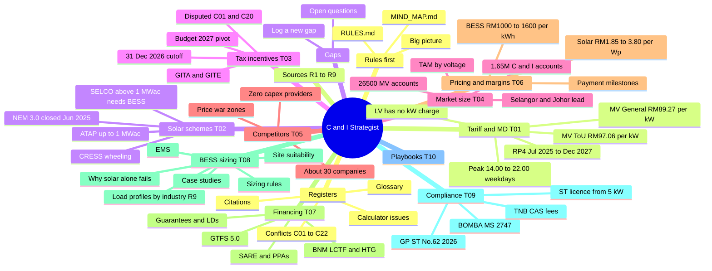

# MIND MAP — what is in this repo and where to look

Read `RULES.md` before this file. Use the routing table (section 3) for every question, and open the files it names.

## 1. Visual map (renders on GitHub)


## 2. Text map (for any AI)
```
RULES.md ............................. read first: role, retrieval loop, truth rules, answer format, gap logging
MIND_MAP.md .......................... this file
kb/
├── 00_INDEX.md ...................... file map + source registry (R1–R9)
├── 01_BIG_PICTURE.md ................ market on one page; key numbers with grades A–D; open questions
├── topics/
│   ├── T01 tariff_rp4_and_maximum_demand ...... RP4 rates, MD = 2 × max 30-min kWh, ToU window, PF surcharge, tariff-switch maths, typical bills
│   ├── T02 solar_schemes_atap_selco_cress ..... NEM closure, ATAP (≤1 MWac, SMP export), SELCO (BESS + RM12/kWp >1 MWac), CRESS, tenders
│   ├── T03 tax_incentives_gita_gite ........... GITA / GITE, Budget 2027 changes (disputed), 31 Dec 2026 cutoff, CA rules, ACA, GSF 2.0
│   ├── T04 market_size_and_geography .......... accounts & GWh by tariff, solar additions, installed BESS, TAM, states & estates, industrial parks & factory counts
│   ├── T05 competitors_and_providers .......... ~30 companies, listed financials, zero-capex terms, price-war zones, EMS moats
│   ├── T06 pricing_margins_payment_terms ...... RM/Wp, RM/kWh, O&M, warranty adders, margins, payment stages, payback claims
│   ├── T07 financing_and_business_models ...... BNM LCTF/HTG, GTFS 5.0, banks, SARE / bilateral / CRESS PPAs, zero-capex BESS, LDs, preferences
│   ├── T08 bess_technical_and_sizing .......... why BESS, load curves, topologies, sizing rules, EMS, DSM, TES, site suitability, load profiles by industry, case studies
│   ├── T09 regulation_safety_compliance ....... agencies, ST licensing, GP/ST/No.62/2026, standards, forms, BOMBA, CAS fees, insurance, EECA
│   └── T10 strategy_playbooks_from_reports .... archetypes, roadmaps, segment strategies, target sectors and associations proposed by the reports
├── registers/
│   ├── conflicts.md ................. C01–C22 disputes between reports (check before quoting numbers)
│   ├── internal_issues.md ........... calculator errors, placeholder vs computed, self-contradictions, figures recycled between reports
│   ├── citations.md ................. all 26 links graded A–D + named laws, guidelines, standards
│   └── glossary.md .................. acronyms
├── context/
│   └── eternalgy_profile_and_analysis.md ... company profile, segment fit, BESS payback rule of thumb (analysis)
└── sources/ ......................... lossless extracts of each report (exact numbers and wording)
    ├── R1 strategy_hub (first round) ......... ATAP vs SELCO, RP4 simulator, CRESS, tax cliff, CAS/BOMBA, EPCC playbook
    ├── R2 md_mitigation_portal (first round) . MD maths, ROI estimator, mitigation ladder, EECA, roadmap
    ├── R3 bess_solutions_dashboard (first) ... bill simulator, dispatch, 12-provider directory, topologies, GITA table
    ├── R4 market_explorer (prompt #2) ........ accounts/GWh, solar additions, BESS inventory, states, TAM — 23 links
    ├── R5 bess_compliance_navigator (#5) ..... GP/ST/No.62/2026, standards, forms, SELCO sizing, BOMBA, CAS, insurance — 3 links
    ├── R6 financing_2026 (#6) ................ banks, GTFS 5.0, PPAs, zero-capex, guarantees, recommender
    ├── R7 green_tax_portal (#1) .............. Budget 2027 GITA/GITE matrix, cutoff mechanics, tax engine, unconfirmed items
    ├── R8 market_benchmark_2026 (#3) ......... prices, top 15 competitors, zero-capex providers, margins, payments
    └── R9 load_profile_analyzer (#4) ......... 11-sector load factors & BESS fit, post-solar bill simulator, 7 case studies, industrial parks, associations
gaps/
├── INDEX.md ......................... open questions the repo cannot answer yet (check before logging)
├── TEMPLATE.md ...................... gap file + GAP block format
└── open/ ............................ one file per gap
research/round2_research_prompts.md .. the prompts that produced R4–R9
raw/reports/ ......................... original HTML reports (R1–R9)
dist/ ................................ generated upload packs for chat apps + Claude skill
evals/questions.md ................... test questions to check an AI after setup
tools/ ............................... build.py (packs, index, skill), check_coverage.py
```

## 3. Routing table — question → files to open
| If the question is about… | Open first | For exact numbers / wording | Check also |
|---|---|---|---|
| Tariff rates, MD charge, ToU window, bill breakdown, power factor, General vs ToU | `kb/topics/T01_tariff_rp4_and_maximum_demand.md` | `kb/sources/R2_md_mitigation_portal.md`, `kb/sources/R4_market_explorer.md` | C04, C05 |
| ATAP, SELCO, NEM, CRESS, export credit, standby charge, MAQ | `kb/topics/T02_solar_schemes_atap_selco_cress.md` | `kb/sources/R1_strategy_hub.md`, `kb/sources/R5_bess_compliance_navigator.md` | C03, C08, C11 |
| GITA, GITE, Budget 2027, tax shield, 31 Dec 2026 deadline, capital allowance | `kb/topics/T03_tax_incentives_gita_gite.md` | `kb/sources/R7_green_tax_portal.md`, `kb/sources/R6_financing_2026.md` | **C01, C02, C20** |
| Market size, accounts, GWh, TAM, states, industrial estates, installed BESS | `kb/topics/T04_market_size_and_geography.md` | `kb/sources/R4_market_explorer.md` | C15 |
| Competitors, zero-capex providers, OEMs, who does what | `kb/topics/T05_competitors_and_providers.md` | `kb/sources/R8_market_benchmark_2026.md`, `kb/sources/R3_bess_solutions_dashboard.md` | C12 |
| Prices (RM/Wp, RM/kWh), O&M, margins, payment terms, payback | `kb/topics/T06_pricing_margins_payment_terms.md` | `kb/sources/R8_market_benchmark_2026.md` | C10, C17, `internal_issues.md` |
| Financing, banks, PPA, SARE, lease, shared savings, guarantees, LDs | `kb/topics/T07_financing_and_business_models.md` | `kb/sources/R6_financing_2026.md` | C13, C18 |
| BESS sizing, dispatch, EMS, which sites suit BESS, DSM, thermal storage | `kb/topics/T08_bess_technical_and_sizing.md` | `kb/sources/R2…`, `R3…`, `R1…`, `R9…` | C08, C17, C22 |
| Load profiles by industry, which sectors to target, load factor, BESS case studies | `kb/topics/T08_bess_technical_and_sizing.md` §8–9 | `kb/sources/R9_load_profile_analyzer.md` | C05, C21, C22, `internal_issues.md` |
| Industrial parks, factory counts, associations and events to reach energy managers | `kb/topics/T04_market_size_and_geography.md` §6a, `kb/topics/T10_strategy_playbooks_from_reports.md` §8 | `kb/sources/R9_load_profile_analyzer.md` | C21 |
| Licensing, ST, BOMBA, CAS, standards, forms, insurance, EECA | `kb/topics/T09_regulation_safety_compliance.md` | `kb/sources/R5_bess_compliance_navigator.md` | C06, C07 |
| "What should we do?" strategy, segments, go-to-market | `kb/topics/T10_strategy_playbooks_from_reports.md` + `kb/context/eternalgy_profile_and_analysis.md` | `private/` if present | — |
| Is this number reliable? | `kb/registers/conflicts.md` | `kb/registers/internal_issues.md`, `kb/registers/citations.md` | grades in `kb/01_BIG_PICTURE.md` |
| What does this acronym mean? | `kb/registers/glossary.md` | — | — |
| Not covered anywhere | `gaps/INDEX.md` | — | log a gap (RULES §6) |

## 4. Status at a glance
| Item | Status |
|---|---|
| Knowledge date | 23 Oct 2026 |
| Reports | R1–R9 extracted losslessly (R9, load profiles by industry, added 23 Oct 2026) |
| Verification | None of the reports has been checked against official sources yet |
| Biggest open issue | Budget 2027 GITA rules [C01, C20] |
