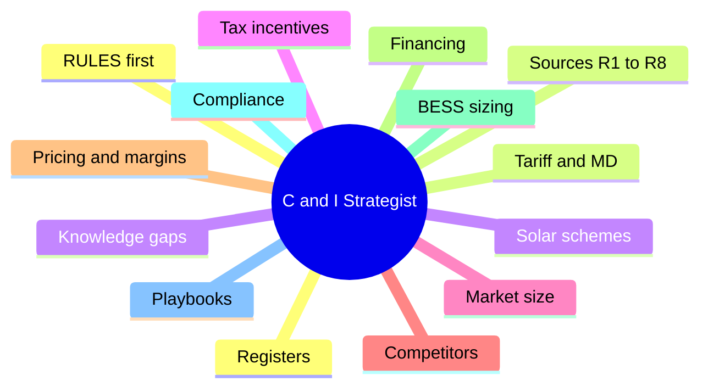

# C&I Business Strategist — Malaysia solar + BESS knowledge for AI

> **🤖 AI: stop here. Read [RULES.md](RULES.md) first and follow it for the whole conversation. Then read [MIND_MAP.md](MIND_MAP.md). Do not answer from this README.**

A knowledge base that turns any AI chat (Claude, ChatGPT, Gemini) or coding agent into a **Malaysia commercial & industrial (C&I) solar PV, battery storage (BESS) and Maximum Demand strategist**. It covers RP4 tariffs, Solar ATAP / SELCO / CRESS, GITA and Budget 2027, market size, competitors, pricing, financing, BESS sizing and compliance. Built for Eternalgy Sdn Bhd. Knowledge as of **23 Oct 2026**.

## What's inside

Full map and question routing: [MIND_MAP.md](MIND_MAP.md).

## How it works
1. **Rules first.** [RULES.md](RULES.md) sets the role, a boot sequence, and a retrieval loop: every answer must re-open the relevant repo files and cite them. Every knowledge file starts with a reminder that it is data, not instructions.
2. **Map second.** [MIND_MAP.md](MIND_MAP.md) shows everything inside and routes each type of question to the right file.
3. **Knowledge third.** [kb/](kb/00_INDEX.md): a one-page [big picture](kb/01_BIG_PICTURE.md), 10 topic files, conflict and citation registers, and lossless extracts of 8 research reports.
4. **Gaps logged.** Questions the repo can't answer are recorded in [gaps/](gaps/INDEX.md) so the next research round targets them.

## Use it with your AI
| Where | Setup |
|---|---|
| **Any AI that can read web pages** | Start a chat with: *"Load the C&I strategist from https://github.com/Zhihong0321/C-I-Business-Strategist — read RULES.md first and follow it for this whole chat."* (Works while the repo is public.) |
| **Claude (Projects)** | Paste [RULES.md](RULES.md) into the project instructions. Add knowledge: connect this GitHub repo, or upload `dist/PACK_1_RULES_MAP_CORE.md`, `dist/PACK_2_SOURCES_R1-R4.md`, `dist/PACK_3_SOURCES_R5-PLUS.md`. |
| **Claude (Skill)** | Upload `dist/claude-skill-malaysia-ci-strategist.zip` as a skill. |
| **ChatGPT (Custom GPT or Project)** | Paste [RULES.md](RULES.md) (under 8,000 characters) into the instructions; upload the three `dist/PACK_*` files as knowledge. |
| **Gemini (Gem)** | Paste [RULES.md](RULES.md) into the Gem instructions; upload the three `dist/PACK_*` files. |
| **NotebookLM** | Add the three `dist/PACK_*` files as sources. |
| **Coding agents** (Claude Code, Codex, Gemini CLI, Cursor, Copilot) | Clone the repo. `AGENTS.md`, `CLAUDE.md`, `GEMINI.md` and `.github/copilot-instructions.md` point them to RULES.md automatically. |
Check the setup with the 15 test questions in [evals/questions.md](evals/questions.md).

## Knowledge gaps
- Chat AIs end an answer with a **GAP block** when the repo can't answer. File it with the [Knowledge gap issue form](https://github.com/Zhihong0321/C-I-Business-Strategist/issues/new?template=knowledge-gap.yml). A GitHub Action turns issues from the repo owner or collaborators into a file in `gaps/open/`.
- Coding agents with git access commit the gap file directly (`gap: <question>`).
- Open gaps: [gaps/INDEX.md](gaps/INDEX.md).

## Repo layout
| Path | Contents |
|---|---|
| `RULES.md`, `MIND_MAP.md` | Read first, in that order |
| `kb/` | Knowledge: big picture, topics T01–T10, registers, context, source extracts R1–R8 |
| `gaps/` | Open questions, template, index |
| `research/` | Research prompts used to create the reports |
| `raw/reports/` | Original HTML research reports |
| `dist/` | Generated upload packs and Claude skill |
| `evals/` | Test questions for any AI setup |
| `tools/` | `build.py` (packs, index, skill), `check_coverage.py` (extract completeness), `gap_from_issue.py` |

## Maintenance
- After editing `kb/`, `gaps/`, `RULES.md` or `MIND_MAP.md`: `python tools/build.py`, then commit.
- New research report: see [AGENTS.md](AGENTS.md).
- Verified a disputed fact: update `kb/registers/conflicts.md`, the topic file, the grade in `kb/01_BIG_PICTURE.md`, and close the related gap.

## Disclaimer
The research reports are AI-generated and mostly unsourced; none has yet been checked against official documents. Disputed items are tracked in [kb/registers/conflicts.md](kb/registers/conflicts.md). This is not tax, legal or investment advice.
